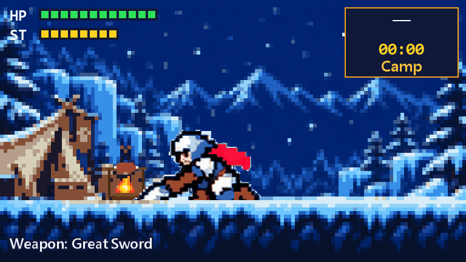
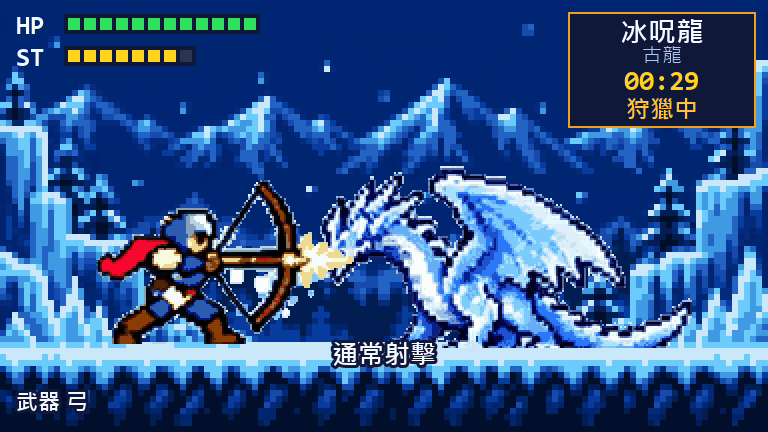

# pixel-hunter

**An 8-bit hunter that fights while Claude works.**

A side pane for Claude Code. When you send Claude a prompt, your hunter leaves camp and hunts one of nine monsters. When Claude answers, the hunter runs back to camp and roasts meat until your next prompt. A hunt takes two to seven minutes of Claude's working time, depending on the monster, and a wounded monster waits for you across turns and sessions.



[繁體中文](README.zh-TW.md)

## Install

At the prompt of a Claude Code terminal session:

```
/plugin install pixel-hunter --marketplace s7788/pixel-hunter
```

Answer `y` to add the marketplace, then pick a scope. The plugin is active right away.

From a shell:

```bash
claude plugin install pixel-hunter --marketplace s7788/pixel-hunter
```

In the desktop app, click **+** next to the prompt box, then **Plugins** → **Add marketplace** with `s7788/pixel-hunter`, then **Add plugin**.

Needs Claude Code 2.1.275 or later (tested on 2.1.304 in the desktop app). The desktop app, VS Code and mobile draw the pixel art. The terminal draws it in character cells, or as an image in terminals that show images (kitty, Ghostty, iTerm2, WezTerm, foot); a button in the pane switches between the two.

The game speaks your language: Traditional Chinese where Claude does, English everywhere else. It follows Claude's `language` setting, then your system locale.

## How it plays

- **Your turn is the hunt.** A prompt sends the hunter out; Claude's answer, or you interrupting it, brings the hunter home. Subagents don't count, only the main turn.
- **A new monster each hunt.** Every new hunt draws one of nine, each on its own hunting ground with its own moves and tricks: Great Jagras swells its belly, Tobi-Kadachi charges up, Anjanath readies fire, Barioth loses its wings, Nargacuga and Tigrex rage, Zinogre supercharges, Ruiner Nergigante grows spikes.
- **The fight runs itself.** The hunter reads the monster's moves: it dodges what would hit it, backs off, runs in, and only swings when the blow would land.
- **Damage is real contact.** Every attack has hit boxes; a blow counts only when they touch the target's body.
- **Progress is kept.** The monster's HP carries over between turns and sessions. Bring it down for a kill; run out of HP and the hunter is carted back to camp, with the monster still wounded. A strip under the picture counts your kills by monster.
- **Pick your weapon at camp.** Under the picture, between turns: **Great Sword**, **Long Sword**, **Bow** or **Random** (a different weapon at once, and again for each new hunt). Each weapon has its own stance, run, dodge and moves, and they're balanced to hunt every monster at about the same pace.

| | Moves | Character |
|---|---|---|
| Great sword | Charged slash, shoulder tackle; true charged slash on an opening | Slow, heavy blows |
| Long sword | Vertical combo, fade slash; spirit roundslash on an opening | Quick cuts, slides back to dodge |
| Bow | Normal shot, quick shot; power shot on an opening | Hits from range |

| Monster | Ground | Minutes |
|---|---|---|
| Great Jagras | Forest | 2 |
| Tobi-Kadachi | Forest | 3 |
| Anjanath | Forest | 4 |
| Velkhana | Snowfield, ice cave | 5 |
| Barioth | Snowfield | 5 |
| Nargacuga | Forest | 5 |
| Tigrex | Snowfield | 5 |
| Zinogre | Forest | 6 |
| Ruiner Nergigante | Crystal ruins | 7 |



## Commands

- `/hunt` opens the pane (it also opens by itself when a session starts).
- `/hunt-demo` starts or ends a hunt without a Claude turn, to try it out.
- `/hunt-demo <monster>` drops the hunt under way and heads out after that monster, for example `/hunt-demo zinogre`.

## Good to know

- **No tokens, no network.** The fight is a small local state machine stepped 8 times a second. It never calls a model, never reads your files and never sends anything anywhere.
- **Light.** A tick takes well under a millisecond. The first time a weapon meets a monster, the game spends about a second working out its damage scale.
- **One hunter.** The save lives in the plugin's own store, so every session shares the same hunter and the same wounded monster.

## Fan project

pixel-hunter is a free, non-commercial, unofficial fan project based on Monster Hunter. It is not affiliated with, endorsed by, or officially licensed by Capcom. Monster Hunter and the underlying character designs belong to their respective rights holders.

This project is intended to follow the [Capcom Fan Content Guidelines](https://www.capcom-games.com/ja-jp/fan-content-guidelines/). Those guidelines include games with added creative expression, restrict commercial use, and exclude direct reuse or processing of official assets and use of official logos. This statement is not a claim of individual approval or a compliance certification from Capcom.

The repository's sprite extraction tool describes its source action boards as AI-generated key-pose images. Sprites are cropped, background-removed, aligned, and palette-quantized from external reference packs; the crystal-ruins scene (S05) is generated by `tools/make_s05.py`. The reference packs and their generation records are not included, so the repository alone does not establish their complete provenance or whether official or third-party images were used as generation inputs. See [NOTICE](NOTICE) and [the asset pipeline](docs/DEVELOPMENT.md#素材管線).

## License

The source code is under the [MIT License](LICENSE). The license does not cover the pixel art (the sprites and scenes in `hooks/gen` and the images in `docs/media`) or the names of the monsters and their moves, which come from the Monster Hunter series; those are not offered for reuse. Monster Hunter is a trademark of Capcom. See [NOTICE](NOTICE).

The non-commercial fan-project statement applies to the Monster Hunter-based work; it does not add a non-commercial restriction to the MIT-licensed source code. MIT does not grant rights to Capcom's intellectual property or to the excluded artwork. Any reuse involving that content requires its own rights assessment under the applicable guidelines or separate permission.

## Contributing

How it's built, the sprite pipeline and the known limits: [docs/DEVELOPMENT.md](docs/DEVELOPMENT.md). Design decisions and the file map: [HANDOFF.md](HANDOFF.md). Checks:

```bash
claude plugin validate .
```

```bash
claude plugin test .
```
