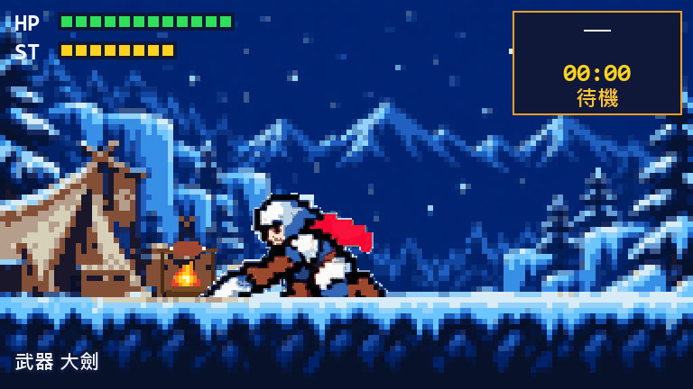

# pixel-hunter

**Claude 在工作，你的 8-bit 獵人在狩獵。**

Claude Code 的側邊 pane。你送出提示，獵人就出營去狩獵九隻魔物之一；Claude 回答完，獵人跑回營地烤肉，等你下一個提示。一場狩獵依魔物不同，大約是 Claude 工作兩到七分鐘的時間；沒打完的魔物會跨回合、跨 session 等你。



[English](README.md)

## 安裝

在 Claude Code 終端機 session 的提示列輸入：

```
/plugin install pixel-hunter --marketplace s7788/pixel-hunter
```

按 `y` 新增 marketplace，再選安裝範圍，裝好立刻生效。

從 shell：

```bash
claude plugin install pixel-hunter --marketplace s7788/pixel-hunter
```

桌面版 app：點提示框旁的 **+** → **Plugins** → **Add marketplace**，填 `s7788/pixel-hunter`，再 **Add plugin**。

需要 Claude Code 2.1.275 以上（在桌面版 2.1.304 實測）。桌面版、VS Code 與手機畫像素圖；終端機用字元格畫，支援圖片的終端機（kitty、Ghostty、iTerm2、WezTerm、foot）也可以改成圖片，pane 上有按鈕切換。

遊戲文字跟著 Claude 的語言：Claude 用繁體中文就顯示中文，其他語言（包括簡體中文）一律顯示英文。先看 Claude 的 `language` 設定，沒設再看系統地區。

## 玩法

魔物被擊倒時，如果 Claude 還在處理同一回合，獵人會完成討伐演出、回營後自動出發狩獵下一隻，持續接續直到 Claude 回答或你中斷它。

- **你的回合就是狩獵。** 送出提示，獵人出營；Claude 回答完或你中斷它，獵人回營。只看主回合，子代理不算。
- **每場一隻新魔物。** 每開一場新狩獵就從九隻中抽一隻，各有自己的狩獵場、招式與機制：大凶豺龍會膨腹、飛雷龍會蓄電、蠻顎龍會準備火焰、冰牙龍的翼會被打破、迅龍與轟龍會憤怒、雷狼龍會超帶電、殲世滅盡龍會長出棘刺。
- **戰鬥自動進行。** 獵人會看魔物的招式：打得到他的就閃、往後退，跑近之後確定打得到才揮刀。
- **碰到才算傷害。** 每一招都有攻擊框，碰到對方身體才扣血。
- **進度會保留。** 魔物的血量跨回合、跨 session 累積，打倒就是討伐；獵人血量歸零會力竭回營，魔物的傷保留。圖片下方有一列討伐統計，記錄每隻魔物打倒幾次。
- **在營地選武器。** 回合之間，圖片下方有「大劍／太刀／弓／隨機」按鈕；按下隨機會立刻換一把不同的武器，之後每開一場新狩獵再換一把。每把武器有自己的姿勢、跑步、閃避與招式，打每隻魔物的速度都調成差不多。

| | 招式 | 特色 |
|---|---|---|
| 大劍 | 蓄力斬、肩撞；硬直或倒地時真蓄力斬 | 慢而重 |
| 太刀 | 縱斬連段、袈裟斬；硬直或倒地時氣刃大迴旋斬 | 出手快，往後滑步閃避 |
| 弓 | 通常射擊、快速射擊；硬直或倒地時剛射 | 能從遠處出手 |

| 魔物 | 狩獵場 | 分鐘 |
|---|---|---|
| 大凶豺龍 | 森林 | 2 |
| 飛雷龍 | 森林 | 3 |
| 蠻顎龍 | 森林 | 4 |
| 冰呪龍 | 雪原、冰洞 | 5 |
| 冰牙龍 | 雪原 | 5 |
| 迅龍 | 森林 | 5 |
| 轟龍 | 雪原 | 5 |
| 雷狼龍 | 森林 | 6 |
| 殲世滅盡龍 | 結晶廢墟 | 7 |


## 指令

- `/hunt`：開啟 pane（session 開始時也會自己打開）。
- `/hunt-demo`：不經 Claude 回合，手動開始或結束一場狩獵，試玩用。
- `/hunt-demo <魔物 id>`：丟下進行中的狩獵，直接出營打指定的魔物，例如 `/hunt-demo zinogre`。

## 你可能想知道

- **不用 token、不連網。** 戰鬥是本機的小狀態機，一秒走 8 步；不呼叫任何模型、不讀你的檔案、不往外送資料。
- **很輕。** 每一步遠低於 1 毫秒。某把武器第一次遇到某隻魔物時，會花大約 1 秒算出傷害倍率。
- **全域只有一位獵人。** 存檔在 plugin 自己的 store，所有 session 共用同一位獵人、同一隻受傷的魔物。

## 同人專案

pixel-hunter 是基於魔物獵人系列的免費、非商業、非官方二次創作專案，與 Capcom 無關，未獲 Capcom 官方認可或個別授權。Monster Hunter 與原作角色設計的權利歸各自權利人所有。

本專案以遵循 [Capcom 二次創作規範](https://www.capcom-games.com/ja-jp/fan-content-guidelines/) 為原則。該規範涵蓋加入創作性的遊戲，限制營利用途，且不涵蓋直接使用或加工官方素材、使用官方 Logo 等行為。此說明不代表 Capcom 已個別核准本專案或認證其符合規範。

依儲存庫擷取工具的記錄，來源動作板為 AI 生成的關鍵姿勢圖片；角色影格由外部參考包裁切、去背、對齊及調色盤量化而來，結晶廢墟場景（S05）則由 `tools/make_s05.py` 程序生成。參考包與生成紀錄未隨儲存庫提供，因此僅憑本儲存庫無法驗證完整素材來源，也無法確認生成時是否使用官方或第三方圖片作為輸入。詳見 [NOTICE](NOTICE) 與[素材管線](docs/DEVELOPMENT.md#素材管線)。

## 授權

程式碼採用 [MIT 授權](LICENSE)。授權範圍不包含像素美術（`hooks/gen` 裡的角色與場景、`docs/media` 裡的圖片），也不包含魔物與招式的名稱：它們來自魔物獵人系列，不開放再利用。Monster Hunter 是 Capcom 的商標。詳見 [NOTICE](NOTICE)。

非商業同人專案的定位適用於涉及魔物獵人內容的作品，不會替 MIT 授權的程式碼新增非商業限制。MIT 不授予 Capcom 智慧財產或上述排除美術的使用權；涉及這些內容的再利用，須另依適用規範確認權利或取得授權。

## 參與開發

架構、素材管線與已知限制見 [docs/DEVELOPMENT.md](docs/DEVELOPMENT.md)。檢查指令：

```bash
claude plugin validate .
```

```bash
claude plugin test .
```
